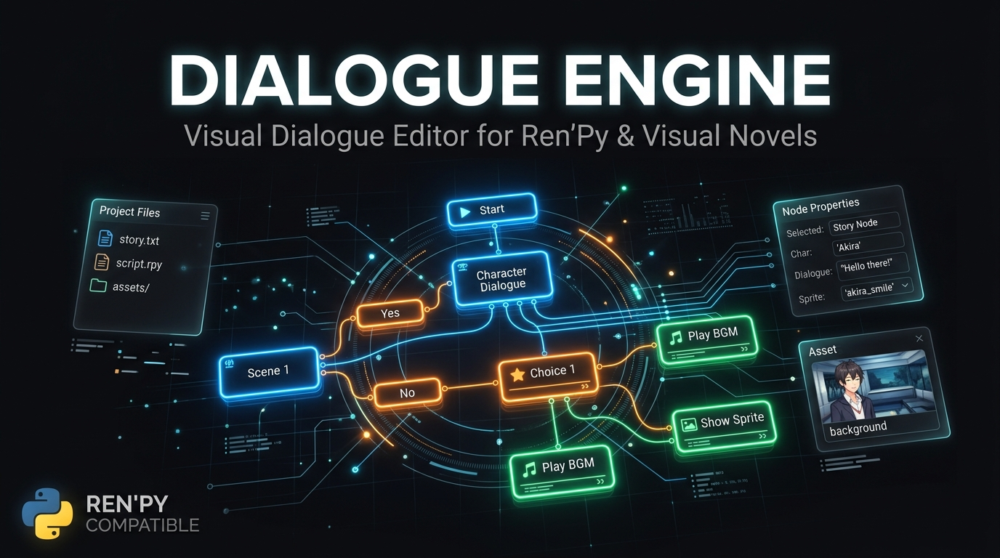

<p align="center">
  
</p>

<h1 align="center">🎭 Dialogue Engine</h1>

<p align="center">
  <b>A visual, node-based narrative & dialogue editor for Ren'Py and visual novel creators.</b><br>
  Design branching storylines, multimedia scenes, audio, and logic visually without manual scripting.
</p>

<p align="center">
  
  
  
  
  
  
</p>

<p align="center">
  <b>🇬🇧 English</b> | <a href="README_RU.md">🇷🇺 Русский</a>
</p>

---

## 📖 What is Dialogue Engine?

**Dialogue Engine** is a free, open-source visual node graph editor designed specifically for Ren'Py visual novel writers, narrative designers, and indie developers.

Connect narrative blocks, choice branches, multimedia sprites, background music/SFX, and conditional logic on an infinite canvas — and generate production-ready `.rpy` scripts with a single click.

---

## ✨ Key Features

### 🎨 Visual Graph Editor
- **Infinite Canvas**: Smooth inertial physics panning (middle-click drag or arrow keys) and precise multi-level zooming (`Ctrl+Wheel`, `Ctrl+Plus`, `Ctrl+Minus`, `Ctrl+0`).
- **Rich Node Presentation**: Story dialogues, multi-branch choices, audio/SFX, conditions (`If / Else`), ATL animations, and python scripts.
- **Per-Word Highlighting**: Format and tint specific words or character names with custom palettes.
- **Search with Camera Focus (`Ctrl+F`)**: Search dialogue lines and speakers with live camera focusing on matched nodes.

### 🛡️ Reliability & Safety
- **Background Autosave & Crash Recovery**: Periodic snapshot saves every 30s (`Save/.autosave/`) and automatic recovery detection upon startup.
- **Atomic File Writing**: Projects are saved atomically with automatic `.bak` backup protection against power outages and data corruption.
- **Full Undo / Redo**: 50-step deep state stack (`Ctrl+Z` / `Ctrl+Y`) with multi-node copy, paste, and duplicate (`Ctrl+C` / `Ctrl+V` / `Ctrl+D`).

### ⚙️ Modular Engine Architecture (v2.0)
- `core/`: Standalone graph models, cycle detection, pathfinding, and JSON serialization.
- `ui/`: Responsive Tkinter canvas, theme presets, and modal dialogs.
- `export/`: Headless & GUI-ready Ren'Py exporter with relative path resolution.
- `plugin_system/`: Plugin system with error boundaries, duplicate protection, and health checks.

---

## 🧩 Built-in Plugins & Capabilities

| Plugin | Description |
|---|---|
| `renpy_exporter.py` | Exports the full node graph to structured, clean `.rpy` Ren'Py code |
| `condition_node.py` | Logic branching (`If / Else`) with dedicated True and False output ports |
| `graph_validator.py` | Scenario health check: finds dead ends, orphans, and unconnected choice branches |
| `quick_playtest.py` | Instant in-editor dialogue simulator without launching external Ren'Py |
| `interactive_player.py` | Launches Ren'Py directly from the editor for fast test-driving |
| `media_node.py` | Sprite, background, and animated GIF integration with transition previews |
| `music_plugin.py` | Music and sound effect nodes with BGM, SFX, and Voice playback modes |
| `pause_plugin.py` | Timed delays and player click pauses |
| `auto_layout.py` | Automatic graph arrangement and grid alignment (`Ctrl+L`) |
| `word_counter.py` | Live project word and line count statistics |
| `advanced_scripting.py` | Raw Ren'Py code and Python block nodes |

> 📚 Want to build custom nodes and tools? Read our complete [Plugin Development Guide (Public API)](docs/PLUGIN_API.md).

---

## 🚀 Quick Start

### Requirements
- Python **3.10+** (also tested on 3.11 and 3.12)
- `tkinter` (bundled with Python on Windows and macOS; install `python3-tk` on Linux)
- Optional: `Pillow>=9.0.0` for animated GIF previews

### Installation & Run

```bash
git clone https://github.com/komendant-zero/dialogue-engine.git
cd dialogue-engine
pip install -r requirements.txt
python main.py
```

### Run Tests

```bash
python -m unittest discover tests -v
```

---

## ⌨️ Shortcuts Reference

| Action | Shortcut |
|---|---|
| **Save Project** | `Ctrl + S` |
| **Open Project** | `Ctrl + O` |
| **Search & Focus** | `Ctrl + F` |
| **Undo / Redo** | `Ctrl + Z` / `Ctrl + Y` |
| **Copy / Paste / Duplicate** | `Ctrl + C` / `Ctrl + V` / `Ctrl + D` |
| **Delete Selected** | `Delete` |
| **Zoom In / Out / Reset** | `Ctrl + +` / `Ctrl + -` / `Ctrl + 0` (or `Ctrl + MouseWheel`) |
| **Pan Canvas** | `Middle Mouse Button` or `Arrow Keys` |
| **Box Select (Marquee)** | `Left-click + Drag on background` |
| **Edit Node** | `Double-click` |
| **Context Menu** | `Right-click` |

---

## 🏗️ Project Structure

```text
dialogue-engine/
├── core/                # Core domain models, GraphModel, serialization, autosave
├── ui/                  # Canvas, themes, node view, modal dialogs, main editor window
├── export/              # Ren'Py code generators
├── plugin_system/       # Plugin manager with error isolation and health checks
├── plugins/             # Built-in and user-installed plugins
├── tests/               # 23+ unit and integration test suite
├── docs/                # Public API documentation
├── .github/workflows/   # Multi-OS CI/CD (Windows, Linux, macOS)
└── main.py              # Application launcher
```

---

## 📄 License

This project is open-source under the **[MIT License](LICENSE)**.
